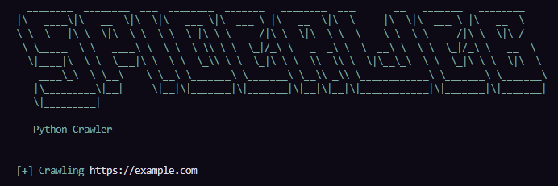

# SpiderWeb 🕷️



SpiderWeb is a lightweight web crawler written in Python. It uses Requests to retrieve web pages and BeautifulSoup to extract links.

## Features

- Simple command-line interface powered by Click.
- Retrieves web pages using Requests.
- Extracts HTML links using BeautifulSoup.
- Resolves relative URLs using urljoin.
- Colored terminal output using Colorama.
- Lightweight and easy to use.

## Requirements

- Python 3.8+
- pip

## Installation

Clone the repository:

```bash
git clone https://github.com/vynzx/SpiderWeb.git
cd SpiderWeb
```

Install SpiderWeb:

```bash
pip install .
```

## Usage

Run SpiderWeb with a target URL:

```bash
spiderweb https://example.com
```

### Help

Display the command-line help:

```bash
spiderweb --help
```

## Dependencies

| Library | Purpose |
|---|---|
| Click | Command-line interface |
| Requests | HTTP requests |
| BeautifulSoup4 | HTML parsing |
| Colorama | Colored terminal output |

See [THIRD-PARTY-NOTICES.md](THIRD-PARTY-NOTICES.md) for third-party license information.

## Disclaimer

SpiderWeb is intended for educational purposes and authorized web crawling.

Always respect website terms of service, crawling policies, and `robots.txt` rules.

Do not use this tool to access or crawl websites without proper authorization.

---

Made with Python 🐍
